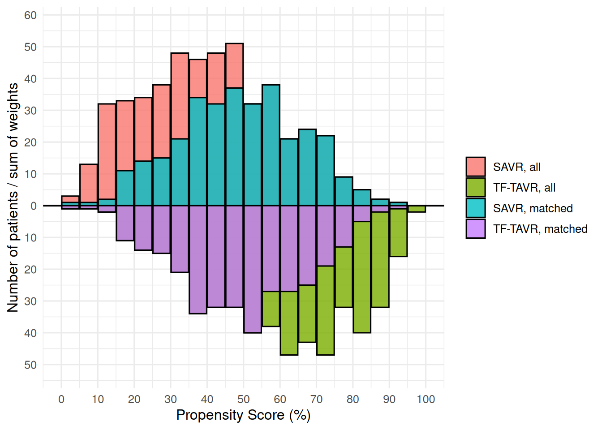
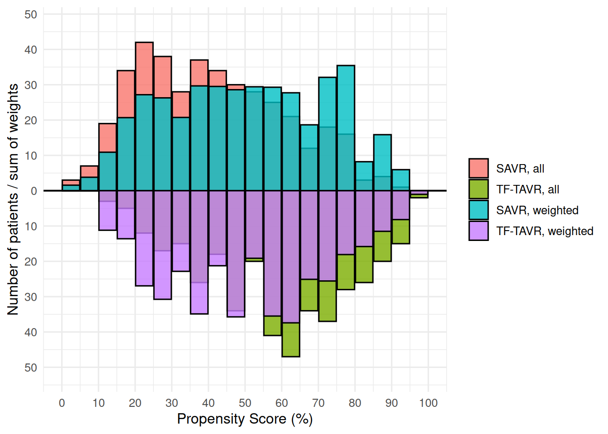
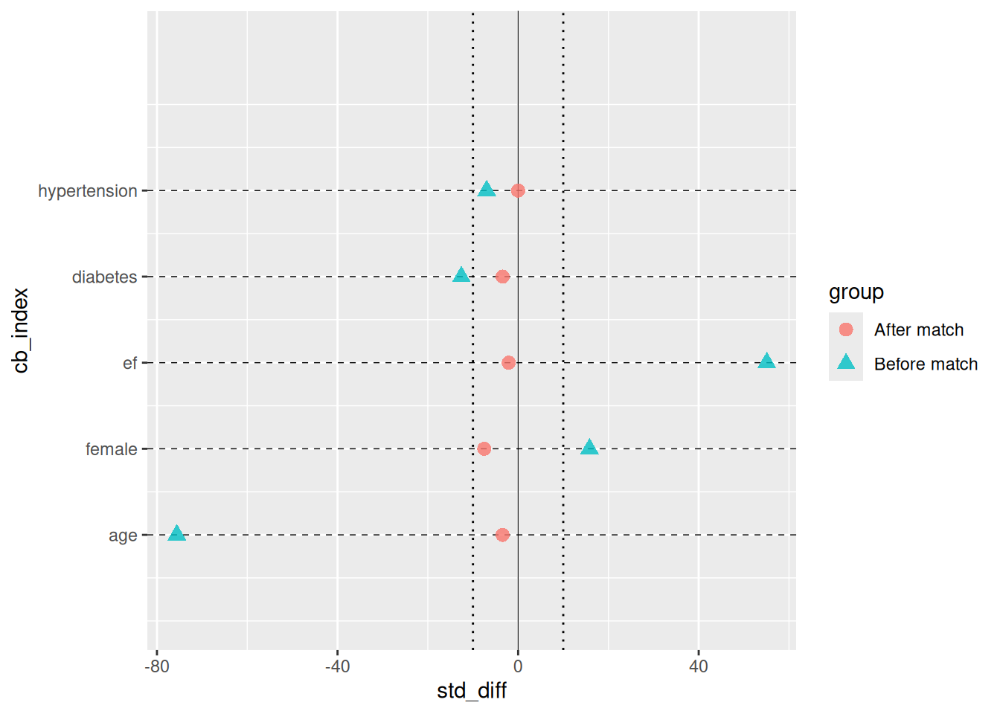

# Introduction to hvtiRpropensity

## 1 Overview

`hvtiRpropensity` provides propensity score methods for cardiac surgery
comparative-effectiveness research. It ports the balancing logic from
six SAS templates into a tidy R API whose outputs feed
[hvtiPlotR](https://ehrlinger.github.io/hvtiPlotR/). The six templates
ship with the package, in
`system.file("sas-templates", package = "hvtiRpropensity")`.

The package covers the full workflow from raw covariates to sensitivity
analysis:

1.  **Estimate a balancing score**:
    [`ps_logistic()`](https://ehrlinger.github.io/hvtiRpropensity/reference/ps_logistic.md),
    [`ps_forest()`](https://ehrlinger.github.io/hvtiRpropensity/reference/ps_forest.md),
    [`ps_ordinal()`](https://ehrlinger.github.io/hvtiRpropensity/reference/ps_ordinal.md),
    [`ps_nominal()`](https://ehrlinger.github.io/hvtiRpropensity/reference/ps_nominal.md),
    [`bs_continuous()`](https://ehrlinger.github.io/hvtiRpropensity/reference/bs_continuous.md),
    [`bs_count()`](https://ehrlinger.github.io/hvtiRpropensity/reference/bs_count.md).
2.  **Balance treatment groups**:
    [`ps_match()`](https://ehrlinger.github.io/hvtiRpropensity/reference/ps_match.md)
    (nearest-neighbour matching) or
    [`ps_weight()`](https://ehrlinger.github.io/hvtiRpropensity/reference/ps_weight.md)
    (IPTW).
3.  **Diagnose balance and support**: the SMD tables, group counts and
    effective sample sizes in `$tables`,
    [`ps_stddiff()`](https://ehrlinger.github.io/hvtiRpropensity/reference/ps_stddiff.md)
    and
    [`ps_stddiff_perm()`](https://ehrlinger.github.io/hvtiRpropensity/reference/ps_stddiff_perm.md),
    and
    [`ps_support()`](https://ehrlinger.github.io/hvtiRpropensity/reference/ps_support.md)
    for the common-support rules.
4.  **Estimate the effect**:
    [`ps_mw_var()`](https://ehrlinger.github.io/hvtiRpropensity/reference/ps_mw_var.md)
    for a matching-weight difference in means,
    [`ps_rmst()`](https://ehrlinger.github.io/hvtiRpropensity/reference/ps_rmst.md)
    for restricted mean survival.
5.  **Check the assumptions**:
    [`sa_overlap()`](https://ehrlinger.github.io/hvtiRpropensity/reference/sa_overlap.md)
    and
    [`sa_trim_sweep()`](https://ehrlinger.github.io/hvtiRpropensity/reference/sa_trim_sweep.md)
    for positivity and overlap,
    [`sa_rosenbaum()`](https://ehrlinger.github.io/hvtiRpropensity/reference/sa_rosenbaum.md)
    and
    [`sa_evalue()`](https://ehrlinger.github.io/hvtiRpropensity/reference/sa_evalue.md)
    for unmeasured confounding.

All score, balance, sensitivity, fit, and validation objects share a
common `ps_data` S3 base class with four slots: `$data` carries
patient-level outputs, `$meta` records the declared contract and row
accounting, `$tables` carries inference and diagnostics, and `$models`
retains every fitted model used to create the result.

------------------------------------------------------------------------

## 2 Sample data

[`sample_ps_data()`](https://ehrlinger.github.io/hvtiRpropensity/reference/sample_ps_data.md)
generates a synthetic cardiac-surgery dataset that mimics a typical SAS
export: two treatment arms (SAVR / TF-TAVR), several continuous and
binary covariates, a fitted propensity score (`prob_t`), and a `match`
indicator initialised to `0`.

``` r

dta <- sample_ps_data(n = 500, seed = 42)
head(dta)
#>   id tavr      age female       ef diabetes hypertension    prob_t match
#> 1  1    0 88.96767      1 35.91940        0            1 0.1072885     0
#> 2  2    0 73.48241      0 32.50216        1            0 0.2258719     0
#> 3  3    0 80.90503      1 48.59300        0            1 0.3249308     0
#> 4  4    0 83.06290      0 53.74726        0            1 0.2872581     0
#> 5  5    0 81.23415      0 29.22222        1            1 0.0920883     0
#> 6  6    0 77.15100      0 54.90524        0            0 0.4674866     0
```

``` r

table(dta$tavr)
#> 
#>   0   1 
#> 500 500
summary(dta$prob_t)
#>    Min. 1st Qu.  Median    Mean 3rd Qu.    Max. 
#> 0.03556 0.34004 0.49508 0.50000 0.67026 0.95645
```

The two treatment groups differ on all covariates (younger patients with
higher ejection fraction were more likely to receive TF-TAVR), so the
raw SMDs are non-trivial and the propensity scores have good overlap.

``` r

hist(
  dta$prob_t,
  breaks = 30,
  main   = "Propensity score distribution",
  xlab   = "Estimated probability of TF-TAVR",
  col    = "steelblue",
  border = "white"
)
```


------------------------------------------------------------------------

## 3 Outcome-model bundles

[`fit_logistic()`](https://ehrlinger.github.io/hvtiRpropensity/reference/fit_logistic.md)
fits binary, proportional-odds ordinal, and generalized-logit nominal
outcome models. The complete outcome levels and the event or reference
level are required. This makes the scientific contrast independent of
factor storage order.

``` r

outcome_model <- fit_logistic(
  tavr ~ age + female + ef + diabetes + hypertension,
  data = dta,
  family = "binary",
  outcome_levels = c(0, 1),
  event_level = 1
)
outcome_model$tables$estimates
#>           term    estimate   std.error statistic  df      p.value    conf.low
#> 1  (Intercept)  4.33969066 0.794459051  5.462447 Inf 4.696151e-08  2.78257953
#> 2          age -0.09351411 0.009427068 -9.919745 Inf 3.416280e-23 -0.11199082
#> 3       female  0.23341073 0.141967346  1.644116 Inf 1.001523e-01 -0.04484016
#> 4           ef  0.04999120 0.006963766  7.178759 Inf 7.034695e-13  0.03634247
#> 5     diabetes -0.32463972 0.158007358 -2.054586 Inf 3.991900e-02 -0.63432845
#> 6 hypertension -0.16776550 0.143950649 -1.165438 Inf 2.438419e-01 -0.44990358
#>     conf.high odds_ratio pooled
#> 1  5.89680179 76.6838145  FALSE
#> 2 -0.07503740  0.9107252  FALSE
#> 3  0.51166161  1.2629001  FALSE
#> 4  0.06363993  1.0512618  FALSE
#> 5 -0.01495099  0.7227877  FALSE
#> 6  0.11437259  0.8455521  FALSE
outcome_model$tables$fit_status
#>   imputation converged n_input n_analyzed n_excluded
#> 1          1      TRUE    1000       1000          0
```

Every bundle records `bundle_version = 1L`, the formula, required
predictors, declared outcome levels, package versions, analysis counts,
all model objects, and four common inference tables:

| table | schema |
|----|----|
| `estimates` | `term`, `estimate`, `std.error`, `statistic`, `df`, `p.value`, `conf.low`, `conf.high`, `odds_ratio` (`rate_ratio` for the log-link count family), `pooled` |
| `covariance` | named coefficient covariance matrix |
| `by_imputation` | `imputation`, `term`, `estimate`, `std.error` |
| `fit_status` | `imputation`, `converged`, `n_input`, `n_analyzed`, `n_excluded` |

For stacked long-form imputations, the same model is fit independently
within each imputation. Predictions are averaged patient by patient,
matching the legacy `PROC SUMMARY mean=` workflow, while coefficient
inference and covariance use Rubin’s rules. These answer different
questions and are stored separately. A missing patient, changed outcome
or categorical predictor level, aliased term, failed fit, or unusable
covariance stops pooling.

``` r

dta_mi <- do.call(rbind, lapply(1:3, function(imputation) {
  partition <- dta
  partition$age <- partition$age + (imputation - 2) / 10
  partition$imputation <- imputation
  partition
}))

outcome_model_mi <- fit_logistic(
  tavr ~ age + female + ef + diabetes + hypertension,
  data = dta_mi,
  family = "binary",
  id_col = "id",
  imputation_col = "imputation",
  outcome_levels = c(0, 1),
  event_level = 1
)
outcome_model_mi$tables$estimates
#>           term    estimate   std.error statistic      df      p.value
#> 1  (Intercept)  4.33969066 0.794532803  5.461940 991.806 5.954560e-08
#> 2          age -0.09351411 0.009427068 -9.919745 992.006 3.535981e-22
#> 3       female  0.23341073 0.141967346  1.644116 992.006 1.004692e-01
#> 4           ef  0.04999120 0.006963766  7.178759 992.006 1.377630e-12
#> 5     diabetes -0.32463972 0.158007358 -2.054586 992.006 4.018051e-02
#> 6 hypertension -0.16776550 0.143950649 -1.165438 992.006 2.441221e-01
#>      conf.low   conf.high odds_ratio pooled
#> 1  2.78053228  5.89884904 76.6838145   TRUE
#> 2 -0.11201339 -0.07501482  0.9107252   TRUE
#> 3 -0.04518007  0.51200152  1.2629001   TRUE
#> 4  0.03632580  0.06365661  1.0512618   TRUE
#> 5 -0.63470676 -0.01457268  0.7227877   TRUE
#> 6 -0.45024824  0.11471725  0.8455521   TRUE
outcome_model_mi$tables$fit_status
#>   imputation converged n_input n_analyzed n_excluded
#> 1          1      TRUE    1000       1000          0
#> 2          2      TRUE    1000       1000          0
#> 3          3      TRUE    1000       1000          0
```

[`validate_logistic()`](https://ehrlinger.github.io/hvtiRpropensity/reference/validate_logistic.md)
scores a validation cohort from a saved binary bundle without refitting
and without modifying the source object. It returns equal-frequency
calibration groups and a performance row containing observed and
expected event counts, O:E ratio, AUC, and Brier score. The first
interface is intentionally binary only.

``` r

validation <- validate_logistic(outcome_model, dta, groups = 10L)
validation$tables$performance
#>      n observed expected oe_ratio     auc     brier
#> 1 1000      500      500        1 0.74406 0.2044163
```

------------------------------------------------------------------------

## 4 Propensity score estimation

### 4.1 Binary treatment: `ps_logistic()`

In practice a propensity score is estimated from covariates before
matching or weighting.
[`ps_logistic()`](https://ehrlinger.github.io/hvtiRpropensity/reference/ps_logistic.md)
fits `stats::glm(..., family = binomial())` and appends several columns
that mirror the original SAS template output:

| R column | SAS equivalent | Description |
|----|----|----|
| `prob_t` | `_p_` / `_propen_` | Propensity score (probability of treatment) |
| `logit_t` | `_logit_` | Log-odds: `log(p / (1 - p))` |
| `mt_wt` | `mt_wt` | Matching weight `min(p, 1-p) / (p·trt + (1-p)·(1-trt))` |
| `quintile` | `quintile` | Rank-based quintile (1–5) |
| `decile` | `decile` | Rank-based decile (1–10) |

``` r

dta_ps <- sample_ps_data(n = 500, seed = 42)
dta_ps$prob_t <- NULL
obj_ps <- ps_logistic(
  tavr ~ age + female + ef + diabetes + hypertension,
  data = dta_ps
)
print(obj_ps)
#> <ps_logistic>
#>   N total     : 1000
#>   Treatment   : tavr
#>   PS column   : prob_t
#>   Weight col  : mt_wt
#>   Method      : logistic
#>   Tables      : smd, group_counts, estimates, covariance, by_imputation, fit_status
```

The scored dataset can be passed directly to
[`ps_match()`](https://ehrlinger.github.io/hvtiRpropensity/reference/ps_match.md)
or
[`ps_weight()`](https://ehrlinger.github.io/hvtiRpropensity/reference/ps_weight.md).

``` r

head(obj_ps$data[, c("id", "tavr", "prob_t", "logit_t", "mt_wt",
                      "quintile", "decile")])
#>   id tavr    prob_t    logit_t     mt_wt quintile decile
#> 1  1    0 0.1072885 -2.1187424 0.1201827        1      1
#> 2  2    0 0.2258719 -1.2317694 0.2917758        1      2
#> 3  3    0 0.3249308 -0.7312031 0.4813295        2      3
#> 4  4    0 0.2872581 -0.9087381 0.4030325        1      2
#> 5  5    0 0.0920883 -2.2883993 0.1014287        1      1
#> 6  6    0 0.4674866 -0.1302375 0.8778869        3      5
```

``` r

m_from_ps <- ps_match(obj_ps$data,
                      score_col = obj_ps$meta$score_col,
                      seed      = 42)
print(m_from_ps)
#> <ps_match>
#>   N total     : 1000
#>   Treatment   : tavr
#>   PS column   : prob_t
#>   Method      : nearest-neighbour 1:1
#>   Tables      : smd_before, smd_after, group_counts_before, group_counts_after
```

### 4.2 Multiply-imputed data

The SAS template fits the model separately on each imputed dataset
(`PROC LOGISTIC ... BY _IMPUTATION_`) and averages predicted
probabilities with `PROC SUMMARY mean=`. Pass a stacked long-format MI
data frame and set `imputation_col` to replicate this.

``` r

dta_base <- sample_ps_data(n = 300, seed = 10)
dta_base$prob_t <- NULL

# Simulate two imputed datasets stacked with an imputation index column
dta_mi <- rbind(cbind(dta_base, imp = 1L),
                cbind(dta_base, imp = 2L))

obj_mi <- ps_logistic(
  tavr ~ age + female + ef + diabetes + hypertension,
  data           = dta_mi,
  imputation_col = "imp",
  id_col         = "id"
)
print(obj_mi)
#> <ps_logistic>
#>   N total     : 600
#>   Treatment   : tavr
#>   PS column   : prob_t
#>   Weight col  : mt_wt
#>   Method      : logistic-MI (2 imputations)
#>   Tables      : smd, group_counts, estimates, covariance, by_imputation, fit_status

# Per-patient PS is averaged across imputations, matching PROC SUMMARY mean=
summary(obj_mi$data$prob_t)
#>    Min. 1st Qu.  Median    Mean 3rd Qu.    Max. 
#> 0.02227 0.30987 0.48499 0.50000 0.68398 0.94193
```

### 4.3 Random-forest score: `ps_forest()`

When you would rather not commit to a main-effects logistic model,
[`ps_forest()`](https://ehrlinger.github.io/hvtiRpropensity/reference/ps_forest.md)
grows a classification forest with `randomForestSRC` and scores each
patient **out-of-bag**, using only the trees that did not see that
patient. It appends the same `prob_t`, `logit_t`, `mt_wt`, `quintile`
and `decile` columns as
[`ps_logistic()`](https://ehrlinger.github.io/hvtiRpropensity/reference/ps_logistic.md),
so everything below takes either. `mt_wt` is the Li and Greene (2013)
matching weight. Give a `seed`; the forest is random.

``` r

op <- options(rf.cores = 2L)
obj_rf <- ps_forest(
  tavr ~ age + female + ef + diabetes + hypertension,
  data  = dta_ps,
  ntree = 200,
  seed  = 42
)
options(op)
summary(obj_rf$data$prob_t)
#>    Min. 1st Qu.  Median    Mean 3rd Qu.    Max. 
#>  0.0010  0.3023  0.4940  0.5005  0.7028  0.9990
obj_rf$tables$smd
#>                  variable     smd
#> age                   age -0.7559
#> female             female  0.1582
#> ef                     ef  0.5509
#> diabetes         diabetes -0.1257
#> hypertension hypertension -0.0696
```

### 4.4 Ordinal treatment: `ps_ordinal()`

For ordered treatment variables (e.g. NYHA functional class I / II /
III–IV),
[`ps_ordinal()`](https://ehrlinger.github.io/hvtiRpropensity/reference/ps_ordinal.md)
fits a proportional-odds cumulative logit model via
[`MASS::polr()`](https://rdrr.io/pkg/MASS/man/polr.html), equivalent to
the default `PROC LOGISTIC` behaviour for ordinal responses in SAS.

The SAS template decomposes cumulative probabilities into marginal
probabilities: `p1 = col1; p2 = col2 - col1; p3 = 1 - col2`.
[`ps_ordinal()`](https://ehrlinger.github.io/hvtiRpropensity/reference/ps_ordinal.md)
performs this decomposition internally, appending one `prob_<level>`
column per level.

``` r

dta_ord <- sample_ps_data_ordinal(n = 400, seed = 1)
obj_ord  <- ps_ordinal(
  nyha_grp ~ age + female + ef + diabetes,
  data = dta_ord
)
print(obj_ord)
#> <ps_ordinal>
#>   N total     : 1200
#>   Treatment   : nyha_grp (3 levels: I < II < III)
#>   Score cols  : prob_I, prob_II, prob_III
#>   Method      : ordinal-logistic
#>   Tables      : smd, group_counts, estimates, covariance, by_imputation, fit_status

# One marginal probability column per level
head(obj_ord$data[, c("id", "nyha_grp",
                       obj_ord$meta$score_cols)])
#>   id nyha_grp    prob_I   prob_II   prob_III
#> 1  1        I 0.4584483 0.4212680 0.12028363
#> 2  2        I 0.7563210 0.2077268 0.03595214
#> 3  3        I 0.6806255 0.2678592 0.05151536
#> 4  4        I 0.3226801 0.4818506 0.19546930
#> 5  5        I 0.5326501 0.3751549 0.09219493
#> 6  6        I 0.4606344 0.4200102 0.11935536

# Quintile distribution (ordered by P(highest level) as in SAS)
table(obj_ord$data$quintile)
#> 
#>   1   2   3   4   5 
#> 240 240 240 240 240
```

### 4.5 Nominal treatment: `ps_nominal()`

For unordered multi-level treatments (e.g. repair type: CE / COS / PER /
DEV),
[`ps_nominal()`](https://ehrlinger.github.io/hvtiRpropensity/reference/ps_nominal.md)
fits a generalised logit model via
[`nnet::multinom()`](https://rdrr.io/pkg/nnet/man/multinom.html),
equivalent to SAS `PROC LOGISTIC ... / link=glogit`. The first factor
level is the reference category (`REF=first` in SAS); use `ref_level` to
override.

``` r

dta_nom <- sample_ps_data_nominal(n = 400, seed = 2)
obj_nom  <- ps_nominal(
  rtyp ~ age + female + ef + diabetes,
  data = dta_nom
)
print(obj_nom)
#> <ps_nominal>
#>   N total     : 1600
#>   Treatment   : rtyp (4 levels)
#>   Reference   : COS
#>   Score cols  : prob_COS, prob_PER, prob_DEV, prob_CE
#>   Method      : nominal-logistic
#>   Tables      : smd, group_counts, estimates, covariance, by_imputation, fit_status

# One probability column per repair type (analogous to p_cos, p_per, etc.)
head(obj_nom$data[, c("id", "rtyp", obj_nom$meta$score_cols)])
#>   id rtyp   prob_COS  prob_PER  prob_DEV    prob_CE
#> 1  1  COS 0.50033813 0.3350304 0.1284198 0.03621158
#> 2  2  COS 0.42351886 0.3367285 0.1771380 0.06261467
#> 3  3  COS 0.07381583 0.1819098 0.3116013 0.43267305
#> 4  4  COS 0.57942852 0.3120193 0.0890958 0.01945643
#> 5  5  COS 0.59403690 0.3002493 0.0874368 0.01827697
#> 6  6  COS 0.46113007 0.3270729 0.1594435 0.05235349
```

------------------------------------------------------------------------

## 5 Balancing scores for continuous and count exposures

When the “treatment” is a continuous or count variable (e.g. units of
RBC transfused, nadir haematocrit), a propensity score is undefined. The
SAS templates instead estimate a **balancing score**: the linear
predictor from a saturated model. Patients with similar balancing scores
have similar expected exposure values, enabling within-stratum
comparisons analogous to PS stratification.

### 5.1 Continuous exposure: `bs_continuous()`

Mirrors `tp.rm.continuous.balncing_score.sas` (PROC REG balancing score
on nadir HCT). The fitted value from
[`stats::lm()`](https://rdrr.io/r/stats/lm.html) is used as the score.

``` r

dta <- sample_ps_data(n = 400, seed = 5)
obj_bs <- bs_continuous(
  ef ~ age + female + diabetes + hypertension,
  data   = dta,
  id_col = "id"
)
print(obj_bs)
#> <bs_continuous>
#>   N total     : 800
#>   Outcome     : ef
#>   Score col   : bs
#>   Strata      : 10 clusters (cluster)
#>   Method      : balancing-linear
#>   Tables      : strata_counts, estimates, covariance, by_imputation, fit_status

# Balancing score and decile-based strata
head(obj_bs$data[, c("id", "ef", "bs", "quintile", "decile", "cluster")])
#>   id       ef       bs quintile decile cluster
#> 1  1 65.29496 56.20983        4      8       8
#> 2  2 61.89769 53.32613        1      1       1
#> 3  3 68.64566 56.37077        4      8       8
#> 4  4 30.80116 54.50480        2      3       3
#> 5  5 53.41481 52.88235        1      1       1
#> 6  6 50.22194 55.33014        3      5       5

# Binary stratum indicators stra_1 ... stra_10 mirror the SAS %grp macro
table(obj_bs$data$cluster)
#> 
#>  1  2  3  4  5  6  7  8  9 10 
#> 80 80 80 80 80 80 80 80 80 80
```

### 5.2 Count exposure: `bs_count()`

Mirrors `tp.pm.count.balncing_score.sas` (PROC GENMOD dist=nb link=log).
The **linear predictor on the log scale** (`xbeta`) is used as the
balancing score, not the fitted count. The log scale is continuous and
unbounded, making it more suitable for rank-based stratification.

``` r

dta_cnt <- sample_ps_data_count(n = 400, seed = 6)

# Negative binomial to account for overdispersion (SAS dist=nb)
obj_cnt <- bs_count(
  rbc_tot ~ female + age + diabetes + hypertension,
  data = dta_cnt,
  dist = "negbin"
)
print(obj_cnt)
#> <bs_count>
#>   N total     : 400
#>   Outcome     : rbc_tot
#>   Score col   : bs
#>   Distribution: negbin
#>   Strata      : 10 clusters (cluster)
#>   Method      : balancing-negbin
#>   Tables      : strata_counts, estimates, covariance, by_imputation, fit_status

head(obj_cnt$data[, c("id", "rbc_tot", "bs", "cluster",
                       "stra_1", "stra_2")])
#>   id rbc_tot        bs cluster stra_1 stra_2
#> 1  1       3 0.8968210       9      0      0
#> 2  2       3 0.3704176       3      0      0
#> 3  3       5 0.7345921       8      0      0
#> 4  4       2 0.9625049      10      0      0
#> 5  5       5 0.4749000       4      0      0
#> 6  6       4 0.9215424      10      0      0
```

------------------------------------------------------------------------

## 6 Propensity score matching

### 6.1 Build the matched object

[`ps_match()`](https://ehrlinger.github.io/hvtiRpropensity/reference/ps_match.md)
performs greedy 1:1 nearest-neighbour matching without replacement.

Treated patients are matched in a shuffled order, so the pairs depend on
the random-number stream. Give `seed` on every call and the match is
reproducible whatever ran earlier in the session.

``` r

m <- ps_match(dta, seed = 42)
print(m)
#> <ps_match>
#>   N total     : 800
#>   Treatment   : tavr
#>   PS column   : prob_t
#>   Method      : nearest-neighbour 1:1
#>   Tables      : smd_before, smd_after, group_counts_before, group_counts_after
```

### 6.2 Diagnostics

[`summary()`](https://rdrr.io/r/base/summary.html) prints the available
diagnostic tables.

``` r

summary(m)
#> Summary of <ps_match>
#> 
#> Smd before:
#>                  variable     smd
#> age                   age -0.7191
#> female             female  0.1005
#> ef                     ef  0.6085
#> diabetes         diabetes -0.1054
#> hypertension hypertension -0.0615
#> 
#> Smd after:
#>                  variable     smd
#> age                   age -0.7191
#> female             female  0.1005
#> ef                     ef  0.6085
#> diabetes         diabetes -0.1054
#> hypertension hypertension -0.0615
#> 
#> Group counts before:
#>   group treated   n
#> 1     0   FALSE 400
#> 2     1    TRUE 400
#> 
#> Group counts after:
#>   group treated   n
#> 1     0   FALSE 400
#> 2     1    TRUE 400
```

The `$tables` slot is a named list you can access directly:

``` r

m$tables$smd_before
#>                  variable     smd
#> age                   age -0.7191
#> female             female  0.1005
#> ef                     ef  0.6085
#> diabetes         diabetes -0.1054
#> hypertension hypertension -0.0615
m$tables$smd_after
#>                  variable     smd
#> age                   age -0.7191
#> female             female  0.1005
#> ef                     ef  0.6085
#> diabetes         diabetes -0.1054
#> hypertension hypertension -0.0615
```

### 6.3 Extract the matched dataset

`$data` is the *full* dataset with a `match` column set to `1` for
matched pairs. Filter to `match == 1` to obtain the matched subset.

``` r

matched <- m$data[m$data$match == 1L, ]
nrow(matched)
#> [1] 800
table(matched$tavr)
#> 
#>   0   1 
#> 400 400
```

### 6.4 Caliper matching

A caliper restricts matches to pairs whose propensity scores differ by
no more than the supplied threshold, reducing the number of matched
pairs in exchange for tighter balance.

``` r

m_cal <- ps_match(dta, caliper = 0.05, seed = 42)
print(m_cal)
#> <ps_match>
#>   N total     : 800
#>   Treatment   : tavr
#>   PS column   : prob_t
#>   Method      : nearest-neighbour 1:1
#>   Tables      : smd_before, smd_after, group_counts_before, group_counts_after
```

### 6.5 Matching on the logit with a caliper in SD units

A caliper of 0.05 on the probability scale means different things near
0.5 and near the tails. Austin (2011) recommends matching on the
**logit** of the propensity score with a caliper of 0.2 pooled standard
deviations of that logit. Pass the `logit_t` column that
[`ps_logistic()`](https://ehrlinger.github.io/hvtiRpropensity/reference/ps_logistic.md)
appends, set `scale = "logit"`, and give the caliper as `caliper_sd`.
[`ps_match()`](https://ehrlinger.github.io/hvtiRpropensity/reference/ps_match.md)
turns it into an absolute caliper,
`caliper_sd * sqrt((var_t + var_c) / 2)`, and records that value in
`$meta$caliper`.

``` r

m_logit <- ps_match(obj_ps$data,
                    score_col  = "logit_t",
                    scale      = "logit",
                    caliper_sd = 0.2,
                    seed       = 42)
m_logit$meta[c("scale", "caliper_sd", "caliper", "n_matched", "n_unmatched")]
#> $scale
#> [1] "logit"
#> 
#> $caliper_sd
#> [1] 0.2
#> 
#> $caliper
#> [1] 0.1893455
#> 
#> $n_matched
#> [1] 322
#> 
#> $n_unmatched
#> [1] 178
m_logit$tables$smd_after
#>                  variable     smd
#> age                   age -0.0345
#> female             female -0.0750
#> ef                     ef -0.0207
#> diabetes         diabetes -0.0343
#> hypertension hypertension  0.0000
```

The object records `scale = "logit"`, and the functions that read it
downstream
([`sa_overlap()`](https://ehrlinger.github.io/hvtiRpropensity/reference/sa_overlap.md),
[`ps_support()`](https://ehrlinger.github.io/hvtiRpropensity/reference/ps_support.md),
[`ps_rmst()`](https://ehrlinger.github.io/hvtiRpropensity/reference/ps_rmst.md))
back-transform the score with
[`plogis()`](https://rdrr.io/r/stats/Logistic.html) before they work on
the probability scale.

------------------------------------------------------------------------

## 7 Inverse-probability-of-treatment weighting

### 7.1 ATE weights (default)

[`ps_weight()`](https://ehrlinger.github.io/hvtiRpropensity/reference/ps_weight.md)
computes IPTW weights and appends them to `$data`. The default estimand
is the **average treatment effect** (ATE).

``` r

w_ate <- ps_weight(dta, estimand = "ATE")
print(w_ate)
#> <ps_weight>
#>   N total     : 800
#>   Treatment   : tavr
#>   PS column   : prob_t
#>   Method      : IPTW-ATE
#>   Tables      : smd_unweighted, smd_weighted, group_counts, effective_n
```

``` r

summary(w_ate)
#> Summary of <ps_weight>
#> 
#> Smd unweighted:
#>                  variable     smd
#> age                   age -0.7191
#> female             female  0.1005
#> ef                     ef  0.6085
#> diabetes         diabetes -0.1054
#> hypertension hypertension -0.0615
#> 
#> Smd weighted:
#>                  variable     smd
#> age                   age -0.0168
#> female             female -0.0151
#> ef                     ef  0.0473
#> diabetes         diabetes  0.0023
#> hypertension hypertension  0.0100
#> 
#> Group counts:
#>   group treated   n
#> 1     0   FALSE 400
#> 2     1    TRUE 400
#> 
#> Effective n:
#>   group treated n_effective
#> 1     0   FALSE       299.6
#> 2     1    TRUE       319.2
```

The `iptw` column holds the stabilised weights.

``` r

head(w_ate$data[, c("id", "tavr", "prob_t", "iptw")])
#>   id tavr    prob_t      iptw
#> 1  1    0 0.7308849 1.8579411
#> 2  2    0 0.3245418 0.7402383
#> 3  3    0 0.7893353 2.3734402
#> 4  4    0 0.1186602 0.5673181
#> 5  5    0 0.1737956 0.6051771
#> 6  6    0 0.4025594 0.8369033
summary(w_ate$data$iptw)
#>    Min. 1st Qu.  Median    Mean 3rd Qu.    Max. 
#>  0.5090  0.6687  0.8189  0.9951  1.1024  5.9547
```

### 7.2 ATT and ATC weights

For the **average treatment effect on the treated** (ATT), treated
patients receive weight `1` and controls receive `ps / (1 - ps)`.

``` r

w_att <- ps_weight(dta, estimand = "ATT")
summary(w_att$data$iptw)
#>     Min.  1st Qu.   Median     Mean  3rd Qu.     Max. 
#>  0.02588  0.64471  1.00000  1.00386  1.00000 10.90944
```

For the **average treatment effect on the controls** (ATC), the roles
are reversed.

``` r

w_atc <- ps_weight(dta, estimand = "ATC")
summary(w_atc$data$iptw)
#>    Min. 1st Qu.  Median    Mean 3rd Qu.    Max. 
#> 0.01808 0.62767 1.00000 0.98627 1.00000 6.73401
```

### 7.3 Weight trimming (winsorisation)

Extreme weights can destabilise estimates. Supplying `trim` winsorises
weights to the (`trim`, `1 - trim`) quantile range.

``` r

w_trim <- ps_weight(dta, estimand = "ATE", trim = 0.05)
summary(w_trim$data$iptw)
#>    Min. 1st Qu.  Median    Mean 3rd Qu.    Max. 
#>  0.5691  0.6687  0.8189  0.9613  1.1024  2.0304
```

------------------------------------------------------------------------

## 8 Balance statistics and effect estimates

The `$tables` of a match or a weight give a quick SMD per covariate.
Three functions port the CCF SAS macros for the fuller analysis, and
tests compare each with the macro’s output.

### 8.1 Standardized differences: `ps_stddiff()`

[`ps_stddiff()`](https://ehrlinger.github.io/hvtiRpropensity/reference/ps_stddiff.md)
reproduces `%stddiff`. You say which formula each variable gets
(Gaussian, non-Gaussian ordinal, binary, categorical) instead of letting
the storage type decide. With `weight_col`, each group’s weights are
first scaled to average 1, so stabilised and unstabilised weights give
the same answer. The result is a proportion of a standard deviation, not
a percent.

``` r

sd_mw <- ps_stddiff(obj_ps$data,
                    gaussian   = c("age", "ef"),
                    binary     = c("female", "diabetes", "hypertension"),
                    weight_col = "mt_wt")
sd_mw$tables$stddiff
#>       variable label     type      stddiff
#> 1          age  <NA> gaussian -0.001631655
#> 2           ef  <NA> gaussian -0.012089771
#> 3       female  <NA>   binary -0.006380083
#> 4     diabetes  <NA>   binary  0.005529868
#> 5 hypertension  <NA>   binary -0.018231400
```

### 8.2 A permutation reference: `ps_stddiff_perm()`

[`ps_stddiff_perm()`](https://ehrlinger.github.io/hvtiRpropensity/reference/ps_stddiff_perm.md)
reproduces `%stddiffci`. It shuffles the group labels and reports where
the observed difference falls among the shuffled ones. The percentiles
are not a confidence interval; they show what label shuffling alone
produces. A weighted run needs a `reweight` function that recomputes the
weights for each permutation, so this example is unweighted.

``` r

perm <- ps_stddiff_perm(obj_ps$data,
                        gaussian = c("age", "ef"),
                        binary   = "female",
                        n_perm   = 200,
                        seed     = 1)
perm$tables$stddiff_perm
#>   variable label     type   observed       p2_5         p16           p50
#> 1      age  <NA> gaussian -0.7559064 -0.1160061 -0.06172352 -0.0029306953
#> 2       ef  <NA> gaussian  0.5508756 -0.1209992 -0.06409435 -0.0006059003
#> 3   female  <NA>   binary  0.1583777 -0.1420472 -0.06075240  0.0040483010
#>          p84     p97_5
#> 1 0.06793955 0.1132619
#> 2 0.04527265 0.1316804
#> 3 0.06886176 0.1257449
```

### 8.3 Matching-weight difference in means: `ps_mw_var()`

[`ps_mw_var()`](https://ehrlinger.github.io/hvtiRpropensity/reference/ps_mw_var.md)
reproduces `%mw_var`: the weighted difference in means between groups,
with a bootstrap standard deviation and percentiles. The weights are
held fixed in the bootstrap, as in the macro, so the SD ignores the
uncertainty in estimating the score. Here `ef` stands in for an outcome.

``` r

mw <- ps_mw_var(obj_ps$data,
                outcomes   = "ef",
                weight_col = "mt_wt",
                n_rep      = 200,
                seed       = 1)
mw$tables$mw_var[, c("outcome", "mean_0", "mean_1", "estimate", "sd",
                     "p2_5", "p97_5")]
#>   outcome   mean_0   mean_1  estimate        sd      p2_5    p97_5
#> 1      ef 54.74937 54.63124 -0.118138 0.6530133 -1.468202 1.174239
```

### 8.4 Restricted mean survival: `ps_rmst()`

For a time-to-event outcome,
[`ps_rmst()`](https://ehrlinger.github.io/hvtiRpropensity/reference/ps_rmst.md)
integrates weighted Kaplan-Meier curves to a horizon `tau` and reports
the treated-minus-control difference with a bootstrap interval. On a
[`ps_match()`](https://ehrlinger.github.io/hvtiRpropensity/reference/ps_match.md)
object it analyses the matched pairs only, unweighted, and resamples
whole pairs. It refuses score weights on a matched set, which would
adjust for the same confounders twice. On a scored or weighted object it
runs the weighting schemes you name.

``` r

# Synthetic follow-up in years, censored at 5
dta_s <- obj_ps$data
dta_s$t <- withr::with_seed(7, stats::rexp(nrow(dta_s), 0.2))
dta_s$e <- as.integer(dta_s$t < 5)
dta_s$t <- pmin(dta_s$t, 5)

m_s <- ps_match(dta_s,
                score_col  = "logit_t",
                scale      = "logit",
                caliper_sd = 0.2,
                covariates = c("age", "female", "ef", "diabetes", "hypertension"),
                seed       = 42)
rm_match <- ps_rmst(m_s, time_col = "t", event_col = "e", tau = 4,
                    n_boot = 100, seed = 1)
rm_match$meta$resampling
#> [1] "pair"
rm_match$tables$estimates[, c("estimator", "n", "diff_days",
                              "lo_days", "hi_days")]
#>        estimator   n diff_days   lo_days  hi_days
#> 1 all/unweighted 644 -20.69227 -119.8038 44.88649
```

------------------------------------------------------------------------

## 9 Sensitivity analysis

A propensity analysis rests on two assumptions the data cannot prove.
The first is positivity: every patient could have received either
treatment, so the two score distributions overlap.
[`sa_overlap()`](https://ehrlinger.github.io/hvtiRpropensity/reference/sa_overlap.md),
[`sa_trim_sweep()`](https://ehrlinger.github.io/hvtiRpropensity/reference/sa_trim_sweep.md)
and
[`ps_support()`](https://ehrlinger.github.io/hvtiRpropensity/reference/ps_support.md)
check it. The second is no unmeasured confounding.
[`sa_rosenbaum()`](https://ehrlinger.github.io/hvtiRpropensity/reference/sa_rosenbaum.md)
and
[`sa_evalue()`](https://ehrlinger.github.io/hvtiRpropensity/reference/sa_evalue.md)
ask how strong an unmeasured confounder would need to be to change the
conclusion. Each `sa_*()` function returns a `ps_data` object, with its
results in `$tables` and `$meta`.

``` r

dta  <- sample_ps_data(n = 500, seed = 42)
m    <- ps_match(dta, seed = 42)
w    <- ps_weight(dta, estimand = "ATE")
```

### 9.1 Overlap and positivity: `sa_overlap()`

Before any analysis, check that the PS distributions overlap
sufficiently.
[`sa_overlap()`](https://ehrlinger.github.io/hvtiRpropensity/reference/sa_overlap.md)
reports the common support region, the fraction of each group outside
it, and near-positivity-violation flags.

``` r

ov <- sa_overlap(m)
ov$meta$overlap_region
#>  lower  upper 
#> 0.0483 0.9015
ov$tables$outside_overlap
#>   group treated n_outside pct_outside
#> 1     0   FALSE         2         0.4
#> 2     1    TRUE        16         3.2
ov$tables$positivity_flags
#>   group treated n_near_zero n_near_one pct_near_zero pct_near_one
#> 1     0   FALSE           3          0           0.6          0.0
#> 2     1    TRUE           1          2           0.2          0.4
```

### 9.2 Comparing support rules: `ps_support()`

There is more than one way to call a patient “off support”.
[`ps_support()`](https://ehrlinger.github.io/hvtiRpropensity/reference/ps_support.md)
flags patients under several rules (outside a fixed trimming range,
outside the range both groups occupy, or any logical flag you supply)
and measures how well the rules agree, with Cohen’s kappa and the
Jaccard overlap of the patients each rule drops.

``` r

sup <- ps_support(obj_ps, trim = c(0.1, 0.9))
sup$tables$counts
#>     rule n_weak    n n_excluded
#> 1 common     18 1000          0
#> 2   trim     37 1000          0
sup$tables$agreement
#>   rule_a rule_b    n n_a n_b n_both n_neither pct_agree     kappa   jaccard
#> 1 common   trim 1000  18  37     18       963      98.1 0.6459715 0.4864865
```

### 9.3 Weight-trimming sensitivity sweep: `sa_trim_sweep()`

Extreme IPTW weights inflate variance and can dominate estimates.
[`sa_trim_sweep()`](https://ehrlinger.github.io/hvtiRpropensity/reference/sa_trim_sweep.md)
sweeps a range of winsorisation thresholds and reports how ESS and the
weight distribution change. Use this to choose a trimming level that
controls extreme weights without unacceptable loss of sample size.

``` r

sweep <- sa_trim_sweep(w, trim_seq = seq(0, 0.10, by = 0.01))$tables$sweep
head(sweep)
#>   trim ess_control ess_treated max_weight sd_weight pct_trimmed
#> 1 0.00       398.7       341.9    10.3568    0.6014           0
#> 2 0.01       413.3       399.0     3.0547    0.4728           2
#> 3 0.02       420.9       407.3     2.6476    0.4450           4
#> 4 0.03       428.7       419.4     2.2002    0.4087           6
#> 5 0.04       431.8       424.2     2.0608    0.3939           8
#> 6 0.05       434.6       428.6     1.9526    0.3804          10

# ESS at no trimming vs. 5% trimming
sweep[sweep$trim %in% c(0, 0.05), c("trim", "ess_control",
                                      "ess_treated", "max_weight")]
#>   trim ess_control ess_treated max_weight
#> 1 0.00       398.7       341.9    10.3568
#> 6 0.05       434.6       428.6     1.9526
```

### 9.4 E-values: `sa_evalue()`

The E-value (VanderWeele & Ding 2017) is the minimum risk-ratio that an
unmeasured confounder would need with *both* the treatment and the
outcome to fully explain away the observed association. A large E-value
indicates a more robust finding. For an odds ratio or hazard ratio you
must say whether the outcome is rare (under about 15 percent by the end
of follow-up) with `rare`; the conversion to a risk ratio depends on it.

``` r

# Suppose a matched analysis yields RR = 1.8 (95% CI 1.3 to 2.5)
ev <- sa_evalue(1.8, ci_lo = 1.3, ci_hi = 2.5, type = "RR")
ev$meta$evalue_estimate   # confounder must be this strong to explain the RR
#> [1] 3
ev$meta$evalue_ci         # must be this strong to explain even the CI lower bound
#> [1] 1.9245
```

``` r

# Risk difference of 0.08 with baseline outcome probability 0.15
ev_rd <- sa_evalue(0.08, ci_lo = 0.02, ci_hi = 0.14,
                   type = "RD", p0 = 0.15)
ev_rd$meta$evalue_estimate
#> [1] 2.437644
```

``` r

# Odds ratio 1.6 (1.1 to 2.3) for a common outcome
ev_or <- sa_evalue(1.6, ci_lo = 1.1, ci_hi = 2.3, type = "OR", rare = FALSE)
ev_or$tables$evalue
#>   quantity value       rr   evalue
#> 1 estimate   1.6 1.264911 1.843780
#> 2       ci   1.1 1.048809 1.275063
```

### 9.5 Rosenbaum sensitivity bounds: `sa_rosenbaum()`

For matched analyses,
[`sa_rosenbaum()`](https://ehrlinger.github.io/hvtiRpropensity/reference/sa_rosenbaum.md)
computes worst- and best-case p-value bounds for the Wilcoxon
signed-rank test under a hidden-bias parameter Γ (Rosenbaum 2002). Γ = 1
means no hidden bias; the **sensitivity value** is the largest Γ at
which the analysis remains significant.

``` r

res <- sa_rosenbaum(m, outcome_col = "ef", gamma_max = 3, gamma_inc = 0.25)

# Summary: how sensitive is the result?
res$meta$sensitivity_value   # largest Gamma where upper p-value < 0.05
#> [1] 2
res$meta$n_pairs
#> [1] 500

# Full bounds table
head(res$tables$bounds)
#>   gamma      p_upper      p_lower reject_upper
#> 1  1.00 1.110223e-16 1.110223e-16         TRUE
#> 2  1.25 4.388009e-10 0.000000e+00         TRUE
#> 3  1.50 4.094436e-06 0.000000e+00         TRUE
#> 4  1.75 1.043090e-03 0.000000e+00         TRUE
#> 5  2.00 2.903425e-02 0.000000e+00         TRUE
#> 6  2.25 1.950801e-01 0.000000e+00        FALSE
```

------------------------------------------------------------------------

## 10 Downstream use with hvtiPlotR

`hvtiPlotR` draws the two standard figures. Both of its constructors
return a data object, and
[`plot()`](https://rdrr.io/r/graphics/plot.default.html) turns that into
a bare `ggplot2` figure you then decorate. The chunks below run when
`hvtiPlotR` is installed.

### 10.1 Mirror histogram

`hv_mirror_hist()` reads the `$data` of a match directly. Its defaults
are the column names this package uses (`prob_t`, `tavr`, `match`). It
plots on the probability scale, so give it `prob_t` even for the
logit-scale match from earlier;
[`ps_logistic()`](https://ehrlinger.github.io/hvtiRpropensity/reference/ps_logistic.md)
left both columns in `$data`. The treated group plots above the axis,
controls below, with matched patients shaded.

``` r

mh <- hvtiPlotR::hv_mirror_hist(m_logit$data,
                                score_col = "prob_t",
                                group_col = "tavr",
                                match_col = "match")
#> mirror_histogram diagnostics: n=1000  dropped=0  [see $tables$diagnostics]
plot(mh)
```



For a weighted analysis, pass the weight column and the bars become
weighted counts.

``` r

mh_wt <- hvtiPlotR::hv_mirror_hist(w_ate$data,
                                   score_col  = "prob_t",
                                   group_col  = "tavr",
                                   weight_col = "iptw")
#> mirror_histogram diagnostics: n=800  dropped=0  [see $tables$diagnostics]
plot(mh_wt)
```



### 10.2 Covariate balance plot

`hv_balance()` does **not** read `$tables` as they come. It wants one
long data frame, one row per covariate and comparison, with columns
`variable`, `group` and `std_diff`, and the difference in **percent**
(its reference lines sit at plus and minus 10). The SMD tables here are
proportions of a standard deviation, one table per comparison, so stack
them and multiply by 100. Here is the logit-scale match from earlier.

``` r

balance_long <- rbind(
  data.frame(variable = m_logit$tables$smd_before$variable,
             group    = "Before match",
             std_diff = 100 * m_logit$tables$smd_before$smd),
  data.frame(variable = m_logit$tables$smd_after$variable,
             group    = "After match",
             std_diff = 100 * m_logit$tables$smd_after$smd)
)
balance_long
#>        variable        group std_diff
#> 1           age Before match   -75.59
#> 2        female Before match    15.82
#> 3            ef Before match    55.09
#> 4      diabetes Before match   -12.57
#> 5  hypertension Before match    -6.96
#> 6           age  After match    -3.45
#> 7        female  After match    -7.50
#> 8            ef  After match    -2.07
#> 9      diabetes  After match    -3.43
#> 10 hypertension  After match     0.00
```

For a
[`ps_weight()`](https://ehrlinger.github.io/hvtiRpropensity/reference/ps_weight.md)
object the two tables are `smd_unweighted` and `smd_weighted`.

``` r

cb <- hvtiPlotR::hv_balance(balance_long)
plot(cb)
```



------------------------------------------------------------------------

## 11 Session info

``` r

sessionInfo()
#> R version 4.6.1 (2026-06-24)
#> Platform: x86_64-pc-linux-gnu
#> Running under: Ubuntu 24.04.5 LTS
#> 
#> Matrix products: default
#> BLAS:   /usr/lib/x86_64-linux-gnu/openblas-pthread/libblas.so.3 
#> LAPACK: /usr/lib/x86_64-linux-gnu/openblas-pthread/libopenblasp-r0.3.26.so;  LAPACK version 3.12.0
#> 
#> locale:
#>  [1] LC_CTYPE=C.UTF-8       LC_NUMERIC=C           LC_TIME=C.UTF-8       
#>  [4] LC_COLLATE=C.UTF-8     LC_MONETARY=C.UTF-8    LC_MESSAGES=C.UTF-8   
#>  [7] LC_PAPER=C.UTF-8       LC_NAME=C              LC_ADDRESS=C          
#> [10] LC_TELEPHONE=C         LC_MEASUREMENT=C.UTF-8 LC_IDENTIFICATION=C   
#> 
#> time zone: UTC
#> tzcode source: system (glibc)
#> 
#> attached base packages:
#> [1] stats     graphics  grDevices utils     datasets  methods   base     
#> 
#> other attached packages:
#> [1] hvtiRpropensity_0.2.1
#> 
#> loaded via a namespace (and not attached):
#>  [1] gtable_0.3.6            xfun_0.61               ggplot2_4.0.3          
#>  [4] hvtiPlotR_2.8.9         htmlwidgets_1.6.4       visNetwork_2.1.4       
#>  [7] lattice_0.22-9          vctrs_0.7.3             tools_4.6.1            
#> [10] generics_0.1.4          parallel_4.6.1          tibble_3.3.1           
#> [13] pkgconfig_2.0.3         Matrix_1.7-5            RColorBrewer_1.1-3     
#> [16] S7_0.2.2                rvg_0.4.2               randomForestSRC_3.9.0  
#> [19] uuid_1.2-2              ggupset_0.4.1           lifecycle_1.0.5        
#> [22] compiler_4.6.1          farver_2.1.2            textshaping_1.0.5      
#> [25] data.tree_1.2.0         fontquiver_0.2.1        fontLiberation_0.1.0   
#> [28] htmltools_0.5.9         yaml_2.3.12             pillar_1.11.1          
#> [31] tidyr_1.3.2             MASS_7.3-65             openssl_2.4.2          
#> [34] fontBitstreamVera_0.1.1 tidyselect_1.2.1        zip_3.0.2              
#> [37] digest_0.6.39           stringi_1.8.9           dplyr_1.2.1            
#> [40] purrr_1.2.2             labeling_0.4.3          splines_4.6.1          
#> [43] fastmap_1.2.0           grid_4.6.1              cli_3.6.6              
#> [46] magrittr_2.0.5          DiagrammeR_1.0.12       patchwork_1.3.2        
#> [49] survival_3.8-6          withr_3.0.3             gdtools_0.5.1          
#> [52] scales_1.4.0            consort_1.2.4           rmarkdown_2.32         
#> [55] officer_0.7.6           otel_0.2.0              nnet_7.3-20            
#> [58] askpass_1.2.1           ragg_1.5.2              ggalluvial_0.12.6      
#> [61] evaluate_1.0.5          knitr_1.52              rlang_1.3.0            
#> [64] Rcpp_1.1.2              glue_1.8.1              xml2_1.6.0             
#> [67] jsonlite_2.0.0          R6_2.6.1                systemfonts_1.3.2
```
